# Sysmon–Wazuh Integration

A practical SOC lab demonstrating Microsoft Sysmon telemetry collection on a Windows endpoint, centralized monitoring with Wazuh SIEM, and a custom detection rule for Sysmon Event ID 11 (FileCreate).

## Project Overview

| Item | Details |
|---|---|
| SIEM | Wazuh |
| Manager | Ubuntu on AWS EC2 |
| Endpoint | Microsoft Windows |
| Endpoint Agent | Wazuh Agent |
| Telemetry Source | Microsoft Sysmon Operational Event Channel |
| Custom Detection | Rule ID `100120`, Severity Level `7` |
| Parent Rule | Built-in Wazuh Rule ID `61613` |

**Lab Status:** Successfully implemented and verified in the documented environment.

## Event Flow

```text
Windows Endpoint
    ↓
Microsoft Sysmon
    ↓
Windows Event Channel
    ↓
Wazuh Agent
    ↓
Wazuh Manager (AWS EC2)
    ↓
Wazuh Detection Rules
    ↓
Wazuh Dashboard
```

## What This Project Demonstrates

- Installing and configuring Microsoft Sysmon.
- Collecting Sysmon Operational events with the Wazuh Agent.
- Verifying telemetry in Windows Event Viewer and Wazuh.
- Understanding the built-in Wazuh parent rule for Sysmon Event ID 11.
- Creating a custom Wazuh rule with a customized alert description.
- Validating XML rules and verifying alerts in `alerts.json` and the Dashboard.

## Repository Structure

```text
Sysmon-Wazuh-Integration/
│
├── README.md
│
├── configuration/
│   ├── wazuh-agent-sysmon-localfile.xml
│   └── local_rules-custom-sysmon-event11.xml
│
├── docs/
│   └── TROUBLESHOOTING.md
│
└── screenshots/
    ├── 01-wazuh-agent-active.PNG
    ├── 02-sysmon-download-and-extraction.PNG
    ├── 03-sysmon-configuration-downloaded.PNG
    ├── 04-sysmon-installation-success.PNG
    ├── 05-sysmon-events-in-event-viewer.PNG
    ├── 06-wazuh-agent-sysmon-configuration.PNG
    ├── 07-wazuh-agent-restarted.PNG
    ├── 10-wazuh-custom-sysmon-rule.PNG
    ├── 11-wazuh-custom-rule-validation.PNG
    ├── 12-sysmon-test-event-generated.PNG
    ├── 13-sysmon-custom-rule-alert-json.PNG
    └── 14-sysmon-custom-rule-dashboard.PNG
```

## Prerequisites

- A working Wazuh Manager and accessible Dashboard.
- A Windows endpoint enrolled with the Wazuh Manager.
- Wazuh Agent running on the Windows endpoint.
- Administrator privileges on Windows.
- SSH access to the Ubuntu-based Wazuh Manager.
- Internet access to download Sysmon and its configuration.

## Implementation

### 1. Verify the Wazuh Agent

Open PowerShell as Administrator:

```powershell
Get-Service -Name Wazuh
```

Expected status: `Running`.

### 2. Download and Extract Sysmon

Download Sysmon from Microsoft's official Sysinternals page:

https://learn.microsoft.com/en-us/sysinternals/downloads/sysmon

Extract the archive to `C:\Sysmon`.

Confirm that `Sysmon64.exe` is present (use the appropriate executable for your system architecture).

### 3. Download the Sysmon Configuration

Use the configuration referenced by the Wazuh lab resource:

https://wazuh.com/resources/blog/emulation-of-attack-techniques-and-detection-with-wazuh/sysmonconfig.xml

Save it as:

`C:\Sysmon\sysmonconfig.xml`

### 4. Install Sysmon

In an elevated PowerShell window:

```powershell
cd C:\Sysmon
.\Sysmon64.exe -accepteula -i .\sysmonconfig.xml
Get-Service -Name Sysmon64
```

Expected status: `Running`.

### 5. Verify Local Sysmon Events

Open Event Viewer (`eventvwr.msc`) and navigate to:

`Applications and Services Logs → Microsoft → Windows → Sysmon → Operational`

Common Sysmon Event IDs include:

| Event ID | Activity |
|---:|---|
| 1 | Process creation |
| 3 | Network connection |
| 5 | Process termination |
| 11 | File creation |
| 12 | Registry object creation/deletion |
| 13 | Registry value set |
| 22 | DNS query |

### 6. Configure the Wazuh Agent

Open the existing Wazuh Agent configuration file as Administrator:

`C:\Program Files (x86)\ossec-agent\ossec.conf`

Add the block from [configuration/wazuh-agent-sysmon-localfile.xml](configuration/wazuh-agent-sysmon-localfile.xml) inside the existing `<ossec_config>` root element.

Do not add a second root element.

Restart the Agent:

```powershell
Restart-Service -Name Wazuh
Get-Service -Name Wazuh
```

### 7. Verify Sysmon Telemetry in Wazuh

In the Wazuh Dashboard, use the appropriate time range and this DQL query:

```text
data.win.system.channel:"Microsoft-Windows-Sysmon/Operational"
```

For Event ID 11:

```text
data.win.system.eventID:11
```

Note: The Dashboard Alerts view displays events that match Wazuh detection rules. Raw event visibility may require archive data collection and configuration; telemetry collection and alert generation are related but distinct.

### 8. Understand the Built-in Parent Rule

The lab uses Wazuh's existing Rule ID `61613` for Sysmon Event ID 11.

This is a built-in ruleset rule.

**Do not copy it into `local_rules.xml` or create a duplicate ID.**

The custom rule uses `61613` as its parent.

### 9. Add the Custom Wazuh Rule

On the Wazuh Manager (Ubuntu on AWS EC2), back up the local rules file:

```bash
sudo cp /var/ossec/etc/rules/local_rules.xml /var/ossec/etc/rules/local_rules.xml.backup
```

Open it:

```bash
sudo nano /var/ossec/etc/rules/local_rules.xml
```

Add the contents of [configuration/local_rules-custom-sysmon-event11.xml](configuration/local_rules-custom-sysmon-event11.xml) inside the existing local rule group (commonly `<group name="local,">`), before its closing `</group>` tag.

Do not remove existing rules, create an unnecessary duplicate group, or reuse a Rule ID already in use.

### 10. Validate and Restart the Manager

```bash
sudo xmllint --noout /var/ossec/etc/rules/local_rules.xml
sudo systemctl restart wazuh-manager
sudo systemctl is-active wazuh-manager
```

Expected service result: `active`.

If validation or restart fails, review the Manager log:

```bash
sudo tail -n 50 /var/ossec/logs/ossec.log
```

### 11. Generate a Controlled FileCreate Test

In elevated PowerShell on Windows:

```powershell
$testFile = "$env:TEMP\Sysmon-Rule-100120-$(Get-Date -Format 'HHmmss').txt"
New-Item -Path $testFile -ItemType File
```

This creates a test file and should generate Sysmon Event ID 11 when the active Sysmon configuration monitors that activity.

### 12. Verify the Custom Alert

On the Wazuh Manager:

```bash
sudo grep '"id":"100120"' /var/ossec/logs/alerts/alerts.json | tail -n 5
```

Expected custom rule fields:

```json
{
  "rule": {
    "level": 7,
    "description": "Sysmon: Windows event detected - Event ID 11",
    "id": "100120"
  }
}
```

In the Dashboard, search:

```text
rule.id:100120
```

Confirm the agent, Sysmon channel, Event ID 11, Rule ID 100120, level 7, and custom description.

The test is benign file-creation activity, not evidence of malware.

## Custom Rule Summary

```xml
<rule id="100120" level="7">
    <if_sid>61613</if_sid>
    <description>Sysmon: Windows event detected - Event ID $(win.system.eventID)</description>
    <group>sysmon,</group>
</rule>
```

This custom rule is scoped to events matched by parent rule `61613` (Sysmon Event ID 11 in this lab). It does not change descriptions for every Sysmon Event ID.

## Lab Evidence & Screenshots

The following screenshots document the actual implementation and verification process.

### 1. Wazuh Agent Status

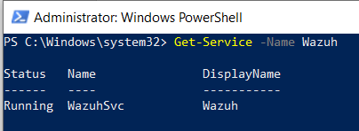

**Description:** Verification that the Wazuh Agent service is running on the Windows endpoint.

### 2. Sysmon Download and Extraction

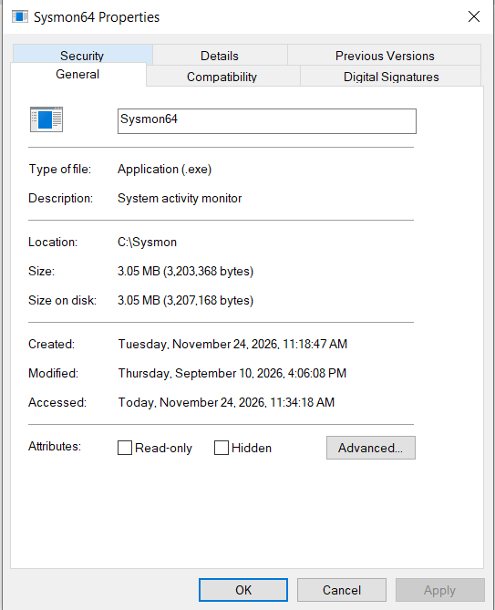

**Description:** Sysmon package downloaded and extracted on the Windows endpoint.

### 3. Sysmon Configuration

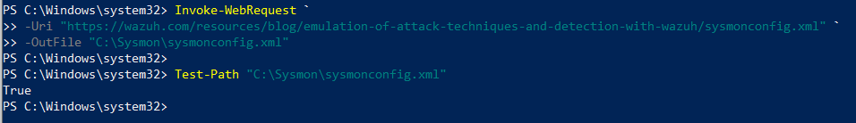

**Description:** Sysmon configuration file downloaded and prepared for installation.

### 4. Sysmon Installation

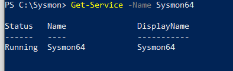

**Description:** Successful installation of Microsoft Sysmon.

### 5. Sysmon Events in Event Viewer

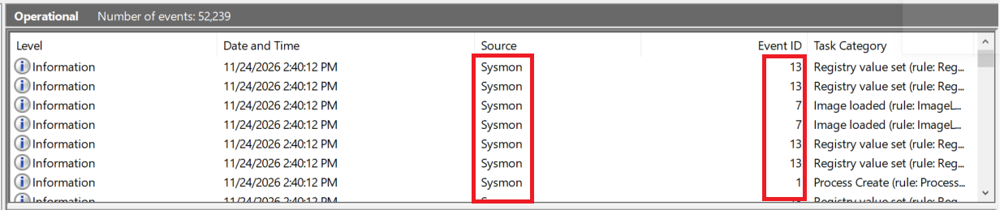

**Description:** Sysmon Operational events visible in Windows Event Viewer.

### 6. Wazuh Agent Sysmon Configuration

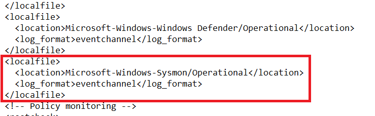

**Description:** Sysmon Event Channel collection configured in the Wazuh Agent.

### 7. Wazuh Agent Restart

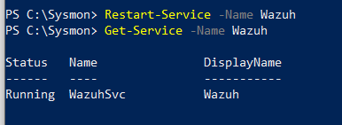

**Description:** Wazuh Agent restarted after configuration changes.

### 8. Custom Wazuh Sysmon Rule

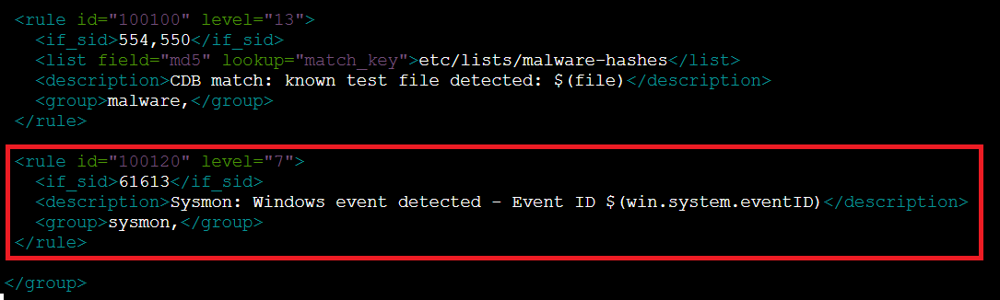

**Description:** Custom Wazuh Rule ID `100120` configured for Sysmon Event ID 11.

### 9. Custom Rule Validation

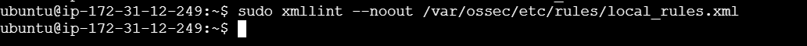

**Description:** XML validation and Wazuh Manager service verification.

### 10. Sysmon Test Event

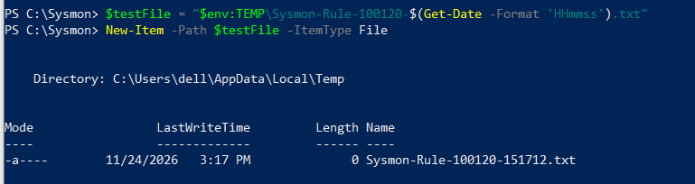

**Description:** Controlled file creation to generate a Sysmon Event ID 11.

### 11. Custom Rule Alert in JSON

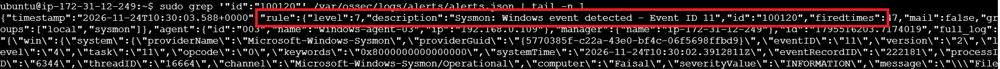

**Description:** Custom Rule ID `100120` verified in Wazuh `alerts.json`.

### 12. Custom Rule Alert in Dashboard

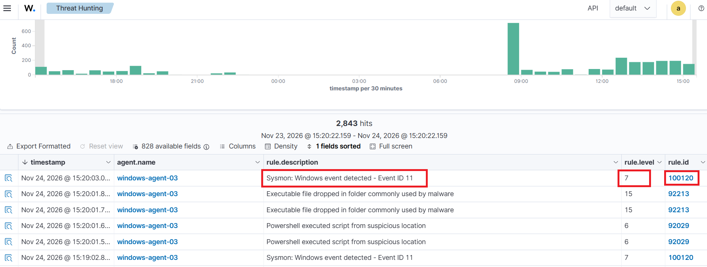

**Description:** Custom Sysmon alert displayed in the Wazuh Dashboard.

## Troubleshooting

See [docs/TROUBLESHOOTING.md](docs/TROUBLESHOOTING.md).

## Security Considerations

- Download Sysmon from Microsoft's official source.
- Use a trusted Sysmon configuration.
- Restrict access to endpoint and Manager configuration files.
- Back up `local_rules.xml` before editing.
- Use unique custom Rule IDs.
- Redact credentials, tokens, account identifiers and sensitive network information from public screenshots.
- Keep Wazuh and Sysmon components updated.

## References

1. [Microsoft Sysinternals – Sysmon](https://learn.microsoft.com/en-us/sysinternals/downloads/sysmon)
2. [Wazuh Documentation](https://documentation.wazuh.com/)
3. [Wazuh – Emulation of Attack Techniques and Detection with Wazuh](https://wazuh.com/resources/blog/emulation-of-attack-techniques-and-detection-with-wazuh/)
4. [Wazuh localfile configuration](https://documentation.wazuh.com/current/user-manual/reference/ossec-conf/localfile.html)
5. [Wazuh Ruleset documentation](https://documentation.wazuh.com/current/user-manual/ruleset/index.html)

---

**Author:** Faisal CyberX

**Purpose:** Practical SIEM and SOC Analyst Portfolio Lab

**Category:** Cybersecurity | SIEM | Endpoint Monitoring | Threat Detection
